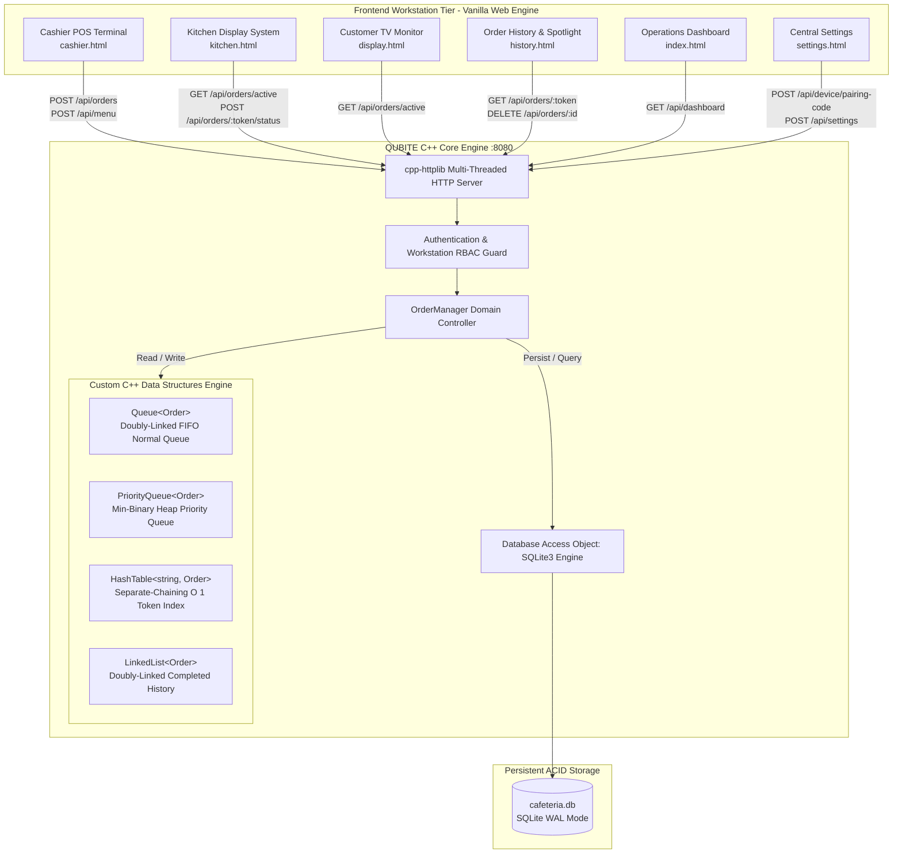
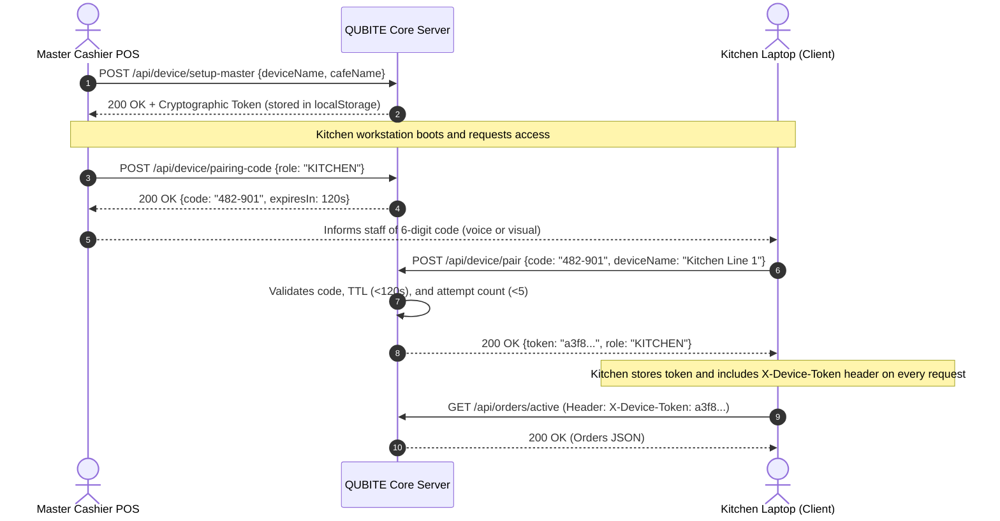
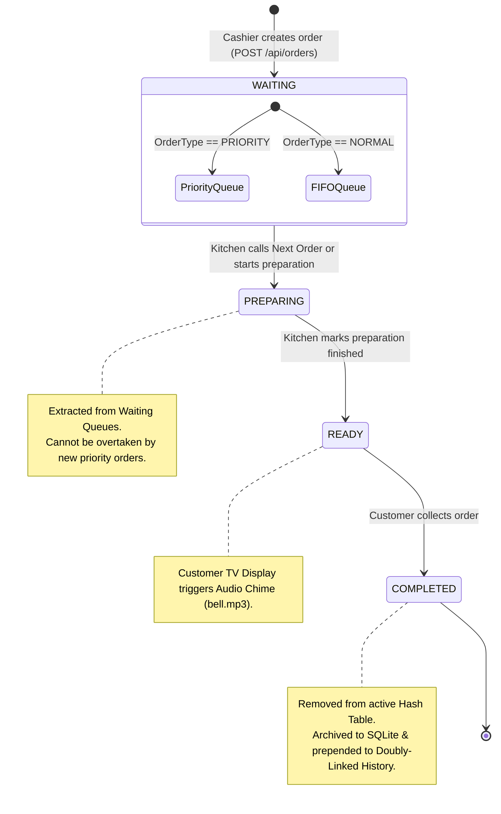
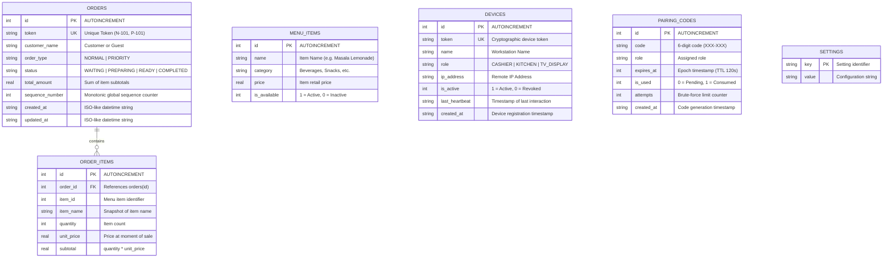

# QUBITE Architecture & Technical Specification

## 1. Executive Architectural Summary

**QUBITE** is an enterprise-grade cafeteria token management and order orchestration system. It is designed to handle high-throughput order entry, real-time kitchen dispatching, and customer pickup notification across distributed hardware terminals over a Local Area Network (LAN).

### Core Architectural Principles
1. **Zero-Dependency Native Backend**: Built using ISO C++17, compiling into a standalone, lightweight binary (`CafeServer.exe`) with minimal memory footprint (~12 MB idle RAM) and near-zero CPU utilization.
2. **Custom-Crafted Data Structures**: No STL collection containers (`std::queue`, `std::priority_queue`, `std::unordered_map`, `std::list`) are used for order queue logic. All queues, priority heaps, hash tables, and history lists are manually engineered from foundational memory primitives.
3. **Hybrid In-Memory + Durable Disk Persistence**: Orders exist simultaneously in custom memory structures for sub-millisecond dispatch and in SQLite3 WAL (Write-Ahead Logging) storage for ACID durability and crash recovery.
4. **Role-Based Air-Gapped Workstations**: Strict separation between Cashier POS, Kitchen Display Systems (KDS), and Customer TV Monitors enforced via ephemeral 6-digit cryptographic pairing handshakes.

---

## 2. High-Level System Architecture



---

## 3. Workstation Security & Pairing Architecture

QUBITE implements a localized zero-trust device management protocol designed for multi-laptop cafeterias without external internet dependencies.



### Authentication Details
- **Token Generation**: Uses a 128-bit cryptographically secure pseudorandom number generator (`std::mt19937_64` seeded with hardware entropy via `std::random_device`).
- **Pairing Codes**: Formatted as `XXX-XXX` (range 100-000 to 999-999) with an automatic 120-second expiration timestamp (`expires_at`).
- **Role Enforcement Matrix**:

| Endpoint | Master Cashier | Paired Cashier | Kitchen Display | TV Display | Public |
|---|:---:|:---:|:---:|:---:|:---:|
| `GET /api/system/status` | Yes | Yes | Yes | Yes | Yes |
| `POST /api/device/setup-master` | Initial Only | No | No | No | First Boot |
| `POST /api/device/pair` | No | No | No | No | Yes (Code) |
| `POST /api/device/pairing-code` | Yes | Yes | No | No | No |
| `GET /api/dashboard` | Yes | Yes | No | No | No |
| `POST /api/orders` (POS Create) | Yes | Yes | No | No | No |
| `POST /api/menu` (Add Item) | Yes | Yes | No | No | No |
| `GET /api/orders/active` | Yes | Yes | Yes | Yes | Fallback |
| `POST /api/orders/:token/status`| Yes | Yes | Yes | No | No |
| `DELETE /api/orders/:id` | Yes | Yes | No | No | No |

---

## 4. In-Depth C++ Data Structures Engine

All custom data structures reside in `backend/structures/` and are templated for modularity and high execution speed.

### 4.1. FIFO Queue: `Queue<T>`
- **Source**: `backend/structures/Queue.h`
- **Underlying Concept**: Doubly-linked node list maintaining direct `head_` and `tail_` pointers.
- **Node Memory Footprint**:
  ```cpp
  template <typename T>
  struct QueueNode {
      T data;
      QueueNode* prev{nullptr};
      QueueNode* next{nullptr};
      explicit QueueNode(const T& val) : data(val) {}
  };
  ```
- **Operations & Complexity**:
  - `enqueue(const T& val)`: Inserts at `tail_`. **Time: $O(1)$**, Space: $O(1)$ per node.
  - `dequeue(T& outVal)`: Extracts from `head_`. **Time: $O(1)$**.
  - `peek(T& outVal)`: Accesses `head_->data`. **Time: $O(1)$**.
  - `removeByPredicate(Predicate pred)`: Searches from `head_` and splices out the matching node. **Time: $O(N)$**.
  - `toVector()`: Traverses from `head_` to `tail_` without mutating queue state. **Time: $O(N)$**.

### 4.2. Min-Binary Heap: `PriorityQueue<T>`
- **Source**: `backend/structures/PriorityQueue.h`
- **Underlying Concept**: Complete binary tree backed by a dynamic contiguous array (`std::vector<T>`), satisfying the min-heap invariant where the highest-priority element resides at index `0`.
- **Heap Invariants**:
  - For node at index $i$:
    $$\text{Parent}(i) = \lfloor (i - 1) / 2 \rfloor$$
    $$\text{LeftChild}(i) = 2i + 1$$
    $$\text{RightChild}(i) = 2i + 2$$
- **Priority Resolution Logic**:
  Orders are evaluated via `PriorityOrderComparator`:
  ```cpp
  struct PriorityOrderComparator {
      bool operator()(const Order& a, const Order& b) const {
          // Smaller sequence number indicates earlier placement (Min-Heap behavior)
          return a.sequenceNumber < b.sequenceNumber;
      }
  };
  ```
- **Operations & Complexity**:
  - `push(const T& val)`: Appends to end of array and calls `heapifyUp(size - 1)`. **Time: $O(\log N)$**.
  - `pop(T& outVal)`: Swaps index `0` with index `size - 1`, shrinks array, and executes `heapifyDown(0)`. **Time: $O(\log N)$**.
  - `top(T& outVal)`: Returns element at index `0`. **Time: $O(1)$**.
  - `removeByToken(const std::string& token)`: Scans array for matching token ($O(N)$), swaps with last element, and conditionally executes `heapifyUp` or `heapifyDown`. **Time: $O(N)$**.
  - `toSortedVector()`: Creates a clone of the heap and repeatedly calls `pop()` to produce a guaranteed priority-ordered vector. **Time: $O(N \log N)$**.

### 4.3. Separate-Chaining Hash Table: `HashTable<K, V>`
- **Source**: `backend/structures/HashTable.h`
- **Underlying Concept**: Fixed array of buckets with singly-linked overflow chains. Provides $O(1)$ average-case indexing for token lookups.
- **Hash Function**:
  Uses Daniel J. Bernstein’s `djb2` string hash algorithm initialized with seed `5381`:
  $$\text{hash} = ((\text{hash} \ll 5) + \text{hash}) + c = \text{hash} \times 33 + c$$
  $$\text{index} = \text{hash} \pmod{\text{capacity}}$$
- **Memory Structure**:
  ```cpp
  template <typename K, typename V>
  struct HashNode {
      K key;
      V value;
      HashNode* next{nullptr};
      HashNode(const K& k, const V& v) : key(k), value(v) {}
  };
  ```
- **Operations & Complexity**:
  - `insert(const K& key, const V& value)`: Computes hash, traverses bucket chain. Updates existing node if key exists; otherwise prepends new node to bucket. **Time: Average $O(1)$, Worst $O(N)$**.
  - `search(const K& key)`: Returns pointer to value or `nullptr`. **Time: Average $O(1)$, Worst $O(N)$**.
  - `remove(const K& key)`: Splices out matching chain node. **Time: Average $O(1)$, Worst $O(N)$**.

### 4.4. Doubly-Linked History List: `LinkedList<T>`
- **Source**: `backend/structures/LinkedList.h`
- **Underlying Concept**: Doubly-linked list optimized for $O(1)$ prepending at head, ensuring completed orders are instantly placed at the top of customer history views.
- **Operations & Complexity**:
  - `prepend(const T& val)`: Inserts new head node. **Time: $O(1)$**.
  - `remove(const std::string& token)`: Traverses and unlinks. **Time: $O(N)$**.
  - `toVector(int limit)`: Collects up to `limit` entries starting from newest. **Time: $O(\min(N, \text{limit}))$**.

---

## 5. Order State Machine & Dispatch Pipeline

Every order created in QUBITE transitions strictly through the following state machine:



### Dispatch Priority Resolution Algorithm
When Kitchen staff trigger **"Call & Start Next Order"** (`GET /api/orders/next`), the backend executes the following logic:
```
1. Acquire std::lock_guard on OrderManager mutex.
2. If PriorityQueue.size() > 0:
      Pop Order from PriorityQueue (earliest sequence number first).
      Update status = PREPARING.
      Persist status change to SQLite.
      Return Order.
3. Else If FIFOQueue.size() > 0:
      Dequeue Order from FIFOQueue (FIFO order).
      Update status = PREPARING.
      Persist status change to SQLite.
      Return Order.
4. Else:
      Return "No waiting orders available".
```

---

## 6. Database Schema & Data Models

QUBITE persists all operational and transactional data in `data/cafeteria.db` using SQLite3.



### Crash Recovery & Startup Resynchronization
When `CafeServer.exe` starts up:
1. SQLite connection is opened and schema migrations are verified.
2. `OrderManager::init()` executes:
   - Queries `SELECT * FROM orders WHERE status != 'COMPLETED'`.
   - Iterates through uncompleted records:
     - Populates in-memory `HashTable` with all active tokens.
     - If `status == 'WAITING'` and `type == 'PRIORITY'`, pushes to `PriorityQueue`.
     - If `status == 'WAITING'` and `type == 'NORMAL'`, enqueues to `Queue`.
   - Queries recent completed orders and prepends them into `LinkedList`.
   - Restores the global monotonic sequence number counter to `MAX(sequence_number) + 1`.

---

## 7. Concurrency & Thread Synchronization

QUBITE runs on `cpp-httplib`, which uses a pre-allocated multi-threaded worker pool. Because multiple HTTP worker threads handle concurrent requests from different terminals, strict synchronization primitives are implemented:

```cpp
class OrderManager {
private:
    std::shared_ptr<Database> db_;
    std::mutex mutex_; // Guards all internal data structures

    Queue<Order> normalQueue_;
    PriorityQueue<Order> priorityQueue_;
    HashTable<std::string, Order> activeOrdersHash_;
    LinkedList<Order> completedOrdersList_;

    std::atomic<uint64_t> globalSequenceNumber_{1};
    std::atomic<int> normalTokenCounter_{101};
    std::atomic<int> priorityTokenCounter_{101};
    ...
```

- **Data Structure Safety**: Every mutating or reading traversal across `normalQueue_`, `priorityQueue_`, `activeOrdersHash_`, and `completedOrdersList_` acquires `std::lock_guard<std::mutex> lock(mutex_)`.
- **Atomic Counters**: Sequence numbers and token sequence numbers are backed by lock-free `std::atomic<int>` and `std::atomic<uint64_t>` primitives, guaranteeing uniqueness without thread starvation.
- **Non-Blocking SQLite Isolation**: SQLite transactions for order creation execute within transaction scopes (`BEGIN IMMEDIATE TRANSACTION; ... COMMIT;`), ensuring file-level locking without deadlocks.

---

## 8. Frontend Architecture & Design System

The frontend is built with high-efficiency vanilla web technologies without virtual DOM overhead, node module dependencies, or bundlers.

### Key Subsystems
1. **API Client (`frontend/js/api.js`)**:
   - Centralizes `apiFetch(url, options)` handling.
   - Automatically injects the `X-Device-Token` header stored in browser `localStorage`.
   - Intercepts `401 / 403` responses and routes workstations to the setup/pairing modal.
   - Handles global toast notifications and currency formatting.
2. **Audio Chime System (`bell.mp3`)**:
   - Initialized via user-interaction unlock on startup.
   - **Strictly isolated to TV Display (`display.js`)**: Kitchen Display (`kitchen.js`) operates silently. The chime triggers only when a token transitions into the "Ready for Collection" list.
3. **Receipt Printing Engine (`cashier.html`)**:
   - Features a dedicated `#printable-token-slip` element.
   - CSS rules under `@media print` hide all viewport chrome, navigation bars, and wrappers (`body > *:not(#token-modal) { display: none !important; }`), guaranteeing that browsers output **strictly 1 page** formatted for standard 80mm POS thermal printers.
4. **Live POS Search & Quick Cart Injection**:
   - Menu items are indexed in memory.
   - Real-time substring filter across item names and categories.
   - Keyboard listener captures <kbd>Enter</kbd> in search input, automatically adding the top match into the active cart and re-highlighting the search box for rapid touchless cashier throughput.

---

## 9. Comprehensive REST API Reference

### System & Authentication Endpoints
- `GET /api/system/status`
  - Returns setup status, active cashier presence, store name, and currency symbol.
- `POST /api/device/setup-master`
  - Body: `{"deviceName": "Cashier Main", "cafeName": "Campus Cafe", "currencySymbol": "₹"}`
  - Registers initial Master Cashier POS terminal.
- `POST /api/device/pairing-code`
  - Body: `{"role": "KITCHEN" | "TV_DISPLAY"}`
  - Generates 6-digit ephemeral code valid for 120 seconds.
- `POST /api/device/pair`
  - Body: `{"code": "482-901", "deviceName": "Kitchen Terminal 1"}`
  - Validates code and assigns a session token to secondary terminal.

### Order Management Endpoints
- `POST /api/orders`
  - Body: `{"customerName": "John", "orderType": "NORMAL"|"PRIORITY", "items": [{"itemId": 1, "itemName": "Coffee", "quantity": 2, "unitPrice": 40.0}]}`
  - Creates order, allocates sequence number, enqueues to custom structures, returns 201 with generated token.
- `GET /api/orders/active`
  - Returns JSON containing `waiting`, `preparing`, and `ready` lists plus queue metric tallies.
- `GET /api/orders/next`
  - Dequeues highest priority waiting order and shifts it to `PREPARING`.
- `GET /api/orders/:token`
  - Resolves token in $O(1)$ time via separate-chaining Hash Table; falls back to SQLite for completed records.
- `POST /api/orders/:token/status`
  - Body: `{"status": "PREPARING" | "READY" | "COMPLETED"}`
  - Moves order across pipeline stages.
- `POST /api/orders/:id/delete`
  - Removes order from database and in-memory structures.
- `POST /api/orders/clear-all`
  - Purges all orders from memory queues and SQLite history.

### Menu Management Endpoints
- `GET /api/menu`
  - Returns active menu items grouped by category.
- `POST /api/menu`
  - Body: `{"name": "Iced Mocha", "category": "Beverages", "price": 95.0}`
  - Inserts new menu item into SQLite table `menu_items` and returns created record.

---

## 10. Summary

QUBITE pairs classical computer science data structures with modern minimalist web design. By bypassing bloated multi-gigabyte frameworks in favor of optimized C++17 algorithms, thread-safe memory models, and zero-dependency web clients, it provides an industrial-grade, deterministic, and educational platform for cafeteria management.
